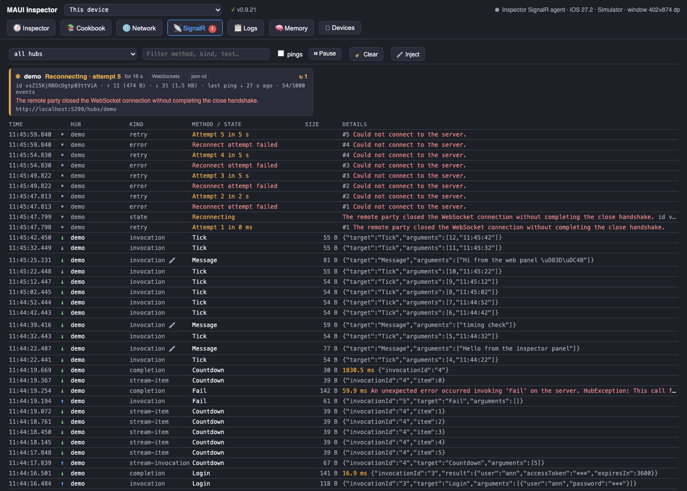

# SignalR

The **📡 SignalR** view shows every hub your app registered: its connection state, reconnects and
the messages in both directions — method, invocation id, size, invoke → completion time and the
arguments (masked, cut to 4 KB). It is the SignalR counterpart of the [Network](Network-and-mocking.md)
view and lives in its own package, so apps without SignalR never pull the client in.



### Setup — one line per hub

```bash
dotnet add package Immons.Tools.Maui.Inspector.SignalR
```

```xml
<!-- Debug-only, like the inspector itself -->
<PackageReference Include="Immons.Tools.Maui.Inspector.SignalR" Version="0.10.0" Condition="'$(Configuration)' == 'Debug'" />
```

```csharp
using Immons.Tools.Maui.Inspector;

var connection = new HubConnectionBuilder()
    .WithUrl(url + "/hubs/chat")
    .WithAutomaticReconnect()
#if DEBUG
    .WithMauiInspector("chat")      // ← the name the panel shows
#endif
    .Build();
```

- **Anywhere in the chain.** Protocol, transport factory and reconnect policy are resolved when
  `Build()` runs, so the order against `WithUrl`, `WithAutomaticReconnect` or
  `AddMessagePackProtocol` / `AddNewtonsoftJsonProtocol` does not matter.
- **Inert without the inspector.** When `UseMauiInspector` was not called the method returns the
  builder untouched — nothing is wrapped. The `#if DEBUG` above matches the Debug-only package
  reference; in builds that keep the package, the line stays harmless.
- **Bytes never change.** The protocol decorator only looks at what the real protocol parsed or wrote;
  the round trip is byte-identical for JSON, Newtonsoft and MessagePack (covered by `tests/SignalRTests`).
- **One name, one timeline.** Apps that build a new `HubConnection` after every failure keep one entry
  per name; the hub card counts the instances.

**Negotiate in the Network view.** Negotiation and long polling are plain HTTP — route them through
the HTTP handler and they show up next to your API calls (failed reconnect attempts included):

```csharp
.WithUrl(url, options =>
{
#if DEBUG
    options.HttpMessageHandlerFactory = inner => new MauiInspectorHttpHandler(inner);
#endif
})
```

Already have a factory (certificates, proxies)? Wrap its result:
`options.HttpMessageHandlerFactory = inner => new MauiInspectorHttpHandler(MyFactory(inner));`.
The WebSocket itself does not go through `HttpMessageHandler` — its frames are what the SignalR view shows.

### Options

```csharp
.WithMauiInspector("chat", o =>
{
    o.MaxPayloadChars = 4096;          // longest payload kept per message (JSON characters)
    o.MaskedFields.Add("iban");        // on top of the built-in list
    o.CapturePayloads = true;          // false = method, id, size only
    o.CapturePings = true;             // false = pings counted, not listed
    o.MaxEvents = 1000;                // ring buffer per hub; the oldest are overwritten
    o.AllowInjection = true;           // the panel's 💉 Inject
})
```

**Masking** happens before anything is stored. Values are replaced with `***` when the field name
contains `token`, `password`, `passwd`, `secret`, `authorization`, `apikey`, `cookie`, `credential`,
`privatekey`, `accesskey`, `sessionid` (case-insensitive, `_` `-` `.` ignored) or equals `pwd`, `pin`,
`otp`, `cvv`, `cvc`, `auth`, `jwt`, `sid` — a whole object under such a key goes too. Strings that
start with `Bearer ` / `Basic ` and JWT-looking strings are masked under any key, and sensitive query
parameters in the hub URL (`access_token=`) as well.

### What the view shows

- **Hub cards** — colored state (green Connected, amber Connecting/Reconnecting with the attempt
  number, red Disconnected), how long, transport (WebSockets / ServerSentEvents / LongPolling),
  protocol, connection id, messages and bytes each way, the last ping, buffer use, the last error and
  the **↻ reconnect counter** (automatic reconnects and app-driven restarts after a drop). Click a card
  to show only that hub. The tab badge counts hubs that are reconnecting or dropped with an error.
- **Timeline** (newest on top) — time with milliseconds, ↑ client → server / ↓ server → client / •
  lifecycle, hub, kind, method, size and details: invoke → completion time, errors, a preview of the
  payload. Completions and stream items are labelled with the method they answer.
- **Lifecycle** — `Connecting`, `Connected`, `Reconnecting` (with the reason), each retry
  (`Attempt 3 in 5 s` — the app's own `IRetryPolicy` answer), `Reconnect attempt failed`,
  `Reconnected`, `Closed` / `Closed with error`, `Start failed`, `Handshake failed`.
- **Details** — click a row: all facts (invocation and connection id, size, duration, time) and the
  payload as formatted JSON, with Copy; incoming calls get **💉 Inject again…**.
- **Filter** by hub and by text (method, kind, state, error, payload preview), **pings** on/off,
  **⏸ Pause** (stops recording messages; states and counters keep going), **🧹 Clear**.

### 💉 Inject — simulate a server call (developer tool)

**Inject** delivers `Method(args…)` to the app as if the server had sent it: the frame enters the
connection's receive path between two server frames, the app's own protocol binds the arguments to
the handler's parameter types and your `On("Method", …)` handler runs for real. Useful to trigger a
chat message, a "call incoming" or a forced logout without a backend.

> ⚠ **It is not a mock.** The handler's side effects are real (state, navigation, local writes) and
> the server knows nothing about it. Use it on development data only.

- Arguments are a JSON array, one item per handler parameter (`["hi"]`, `[{"id":1,"text":"…"}]`);
  a single JSON value is one argument. A wrong count or type shows up on the timeline as a binding error.
- The injected invocation has no invocation id — the client never answers the server about it.
- Available for text protocols (JSON, Newtonsoft) on a connected hub, not with stateful reconnect
  (it would shift the server's message acknowledgements). The hub card / inject form says why when
  it is unavailable. Turn it off per hub with `AllowInjection = false`.
- Over HTTP: `POST /api/signalr/inject {hub, method, args}` — see [HTTP API](HTTP-API.md).

### Try it with the sample

```bash
dotnet run --project samples/Immons.Tools.Maui.Inspector.SignalRServer   # http://0.0.0.0:5299, hub /hubs/demo
```

Start the sample app, tap **📡 SignalR demo → Connect**, then Echo, Shout (server → client), Login
(masked password and token), Countdown (a stream) and Failing call. Kill the server process and start
it again to watch Reconnecting → attempts → Reconnected. The server pushes a `Tick` every 10 s.
The Android emulator reaches it at `10.0.2.2:5299`; `HV_SIGNALR_URL` overrides the address.

### Limitations

- **MessagePack (and other binary protocols)** — recorded, but the payload is rebuilt from the .NET
  objects the protocol produced or was given (serialized with System.Text.Json), not decoded from the
  wire bytes; objects that cannot be serialized show their type name. Injection is unavailable.
- **Round-trip time** — SignalR pings are not echoed, so there is no ping RTT; the view measures
  invoke → completion per call instead (and shows when the last ping arrived).
- **Client → server streams** (`IAsyncEnumerable`/`ChannelReader` arguments) — their items are
  listed as stream items without the method name.
- **Stateful reconnect** — messages the client re-sends after a stateful reconnect come from
  SignalR's own buffer and are not listed again.
- **Transport name** — read from the HTTP connection by reflection; blank when that changes.
